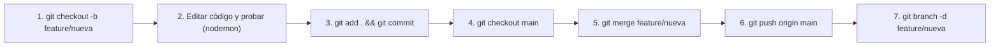

# 📖 Guía Práctica de Git: Ramas, Conceptos y Comandos Esenciales

Esta guía resume los conceptos fundamentales y los comandos diarios para trabajar con ramas y cambios de forma ordenada y sin miedo a perder código.

---

## 🧠 1. Conceptos Clave (El modelo mental)

### Git vs GitHub
* **Git:** Es el motor que vive en tu computadora. Se encarga de rastrear versiones, gestionar ramas, hacer commits y proteger tu código de pérdidas.
* **GitHub:** Es el servidor en la nube donde almacenas copias de respaldo de tus repositorios locales (`git push`) para compartir tu trabajo o tenerlo asegurado en línea.

### "Cambios flotantes" vs "Estampado oficial" (Working Tree vs Commit)
1. **El Árbol de Trabajo (Working Tree):** Cuando editas líneas o creas archivos nuevos (como este mismo archivo), los cambios están **"flotando"** en tu disco. No pertenecen a ninguna rama en particular todavía.
2. **El "Arrastre" entre ramas:** Si te cambias de rama (`git checkout main`) sin hacer commit, esas modificaciones flotantes **te acompañan a la otra rama** porque Git intenta no borrarlas.
3. **El Commit (Punto de guardado / Estampado):** Al hacer `git add .` y `git commit`, tomas una fotografía permanente del proyecto y **estampas** esos cambios exclusivamente en la rama en la que estás parado. A partir de ahí, ya no te siguen a otras ramas.
4. **Conflictos:** Si intentas cambiar de rama y la rama destino tiene cambios diferentes en las mismas líneas que tienes "flotando", Git te bloqueará el paso para evitar pisar tu trabajo y te pedirá hacer `commit` o `stash`.

---

## 🌿 2. Gestión de Ramas

### Ver en qué rama estás y listar ramas
```bash
# Ver únicamente el nombre de la rama activa (rápido y directo)
git branch --show-current

# Ver todas las ramas locales (la activa se resalta con un * en verde)
git branch

# Ver ramas locales y también las remotas en GitHub
git branch -a
```

### Crear y cambiar de ramas
```bash
# Crear una nueva rama y saltar a ella de inmediato
git checkout -b feature/nombre-de-la-rama

# Cambiar a una rama ya existente
git checkout main
```
*(En versiones modernas de Git también puedes usar `git switch <rama>` y `git switch -c <nueva-rama>`).*

### Renombrar ramas
```bash
# Renombrar la rama en la que estás actualmente
git branch -m nuevo-nombre

# Renombrar otra rama estando en una diferente
git branch -m nombre-antiguo nombre-nuevo
```

---

## 🗑️ 3. Eliminar Ramas (Local vs GitHub)

> **Nota:** No puedes borrar una rama si estás parado en ella. Primero salta a otra rama (por ejemplo `git checkout main`).

### A) Borrar una rama en tu computadora (Local)
```bash
# Borrado seguro (solo te permite borrar si ya fusionaste sus cambios en main)
git branch -d feature/nombre-de-la-rama

# Borrado forzado (borra la rama aunque tenga cambios no fusionados)
git branch -D feature/nombre-de-la-rama
```

### B) Borrar una rama de GitHub (Nube)
Borrar la rama en GitHub **no borra** tu copia local. Si luego haces `git push origin nombre-de-la-rama`, volverá a subir a la nube.
```bash
git push origin --delete feature/nombre-de-la-rama
```

---

## 🎒 4. Guardar cambios en el "bolsillo" temporal (`git stash`)

Úsalo cuando tienes trabajo a medias (cambios flotantes) que no quieres commitear todavía pero necesitas cambiar de rama con urgencia para revisar otra cosa:

```bash
# 1. Guarda temporalmente todos los cambios flotantes y deja el editor limpio
git stash

# 2. (Cambias de rama, haces lo que necesites y vuelves a tu rama original)
git checkout feature/mi-rama

# 3. Saca los cambios del bolsillo y los vuelve a pintar en tu editor tal como los dejaste
git stash pop

# (Opcional) Ver la lista de lo que tienes guardado en el bolsillo
git stash list
```

---

## 🔄 5. El Ciclo de Trabajo Recomendado (Flujo Pro)



1. **Crear y entrar a la rama feature:**
   ```bash
   git checkout -b feature/nueva-funcionalidad
   ```
2. **Desarrollar y probar en vivo:**
   Inicias el servidor (`npm run dev`) y editas el código. Nodemon detectará los cambios en tu disco al instante.
3. **Estampar los cambios en la rama:**
   ```bash
   git add .
   git commit -m "Descripción clara de lo que se agregó o corrigió"
   ```
4. **Respaldar la rama en GitHub (opcional mientras trabajas):**
   ```bash
   git push -u origin feature/nueva-funcionalidad
   ```
5. **Fusionar en la rama principal cuando todo funcione:**
   ```bash
   git checkout main
   git merge feature/nueva-funcionalidad
   git push origin main
   ```
6. **Limpiar la rama terminada (opcional):**
   ```bash
   git branch -d feature/nueva-funcionalidad
   git push origin --delete feature/nueva-funcionalidad
   ```
